[English](./README.md) · [Website](https://agentfuse.lei6393.com) · [GitHub](https://github.com/SuperMarioYL/agentfuse)

<picture>
  <source media="(max-width: 600px) and (prefers-color-scheme: dark)" srcset="./assets/presentation/hero-mobile-dark.svg">
  <source media="(max-width: 600px)" srcset="./assets/presentation/hero-mobile-light.svg">
  <source media="(prefers-color-scheme: dark)" srcset="./assets/presentation/hero-dark.svg">
  
</picture>

# AgentFuse

**为每个 Agent 项目设定支出边界**

AgentFuse 启动命令时插入本地 API 代理，在转发请求前检查预算，并把用量写入本地账本。先核对模型价格，再使用费用估算设置项目上限。

## 为什么需要它

自动运行的编程会话可能在查看账单前就发出大量 API 请求。项目预算把下一次请求变成明确决策：代理预留估算费用，转发获准请求，再依据响应中的用量结算。

- **项目或每日窗口** — 可使用项目累计上限，或按本地午夜重置的每日窗口。
- **查看估算依据** — 无需调用服务商即可查看内置价格、覆盖值、未知模型回退和价格差异。
- **保留本地账本** — bbolt 保存请求数、Token 用量和按配置计算的费用，供 status 查询。

## 架构

<picture>
  <source media="(max-width: 600px) and (prefers-color-scheme: dark)" srcset="./assets/presentation/architecture-mobile-dark.svg">
  <source media="(max-width: 600px)" srcset="./assets/presentation/architecture-mobile-light.svg">
  <source media="(prefers-color-scheme: dark)" srcset="./assets/presentation/architecture-dark.svg">
  
</picture>

启动器为子命令改写服务商基础 URL。代理检查账户并在 bbolt 账本中预留预算，再通过对应协议处理器转发请求。返回用量用于结算预留费用；支持的用量缺失场景由本地 Token 估算补充。价格解析器统一处理模型前缀匹配和覆盖优先级。

| 组件 | 职责 |
| --- | --- |
| `Launcher` | internal/cli/run.go |
| `Proxy` | account and provider handlers |
| `Ledger` | atomic budget reservations |
| `Price resolver` | bundled table and overrides |

## 安装与快速上手

需要 Go 1.24 或更新版本。示例无需凭据。

```bash
git clone https://github.com/SuperMarioYL/agentfuse.git
cd agentfuse
go build -o bin/fuse ./cmd/fuse
```

随仓 Go 示例使用实际价格解析器查询 gpt-4o 与未收录模型。Token 数量是明确给定的示例输入，不来自在线响应。

```bash
go run ./examples/presentation
```

## 实际运行示例

<picture>
  <source media="(max-width: 600px) and (prefers-color-scheme: dark)" srcset="./assets/presentation/process-mobile-dark.svg">
  <source media="(max-width: 600px)" srcset="./assets/presentation/process-mobile-light.svg">
  <source media="(prefers-color-scheme: dark)" srcset="./assets/presentation/process-dark.svg">
  
</picture>

Two local model lookups; configured costs only, no API billing measurement.

```text
Bundled price snapshot: 2026-05
openai/gpt-4o explicit=true input_per_1k=0.0025 output_per_1k=0.0100
  configured cost for 1000 input + 100 output tokens: $0.0035
openai/unlisted-demo-model explicit=false input_per_1k=0.0050 output_per_1k=0.0200
  configured cost for 1000 input + 100 output tokens: $0.0070
Scope: local price-table arithmetic; no provider request or measured spend.
```

完整命令与输出保存在 [docs/demo-results.json](./docs/demo-results.json). 输入和复现代码均随仓提供。

## 用法

构建后将本仓库 bin 目录加入 PATH，或使用二进制完整路径。在目标项目中，init 创建 .fuse.toml，cap 修改上限，status 查询账本。配置好 API 客户端后，fuse run <command> 启动代理并跟随子进程退出。命名账户需要对应的账户配置。

```bash
cd /path/to/your/project
fuse init --cap 5
fuse prices --check openai/gpt-4o --diff
fuse status
fuse cap +5
```

## 配置

最近的 .fuse.toml 定义 cap_usd、window（project/daily）、account、provider 和可选 upstream_url。openai_compat 必须填写上游 URL。~/.fuse/accounts.toml 保存命名账户凭据，~/.fuse/prices.toml 覆盖模型价格，~/.fuse/ledger.db 保存用量。内置价格是历史快照，不会自行联网更新。

```toml
cap_usd = 5.0
window = "project"
provider = "openai"
account = ""
```

## 集成与职责分工

<picture>
  <source media="(max-width: 600px) and (prefers-color-scheme: dark)" srcset="./assets/presentation/integrations-mobile-dark.svg">
  <source media="(max-width: 600px)" srcset="./assets/presentation/integrations-mobile-light.svg">
  <source media="(prefers-color-scheme: dark)" srcset="./assets/presentation/integrations-dark.svg">
  
</picture>

服务商处理器适配请求和响应格式；所选客户端须遵循启动器设置的基础 URL。AgentFuse 统计经过其代理的流量。本地价格表与服务商最终账单是两个不同依据。

| 路径 | 已实现职责 |
| --- | --- |
| Anthropic | Messages API handler |
| OpenAI | Chat Completions and Responses |
| Gemini | GenerateContent handlers |
| DeepSeek / compatible | OpenAI-shaped API routes |
| TOML + bbolt | configuration and local ledger |

## 限制与后续方向

- 预算决策依赖配置价格、输出估算和支持的用量解析，不能保证服务商最终账单金额。
- 记录的示例仅运行价格解析，没有验证在线代理流量或账户凭据。
- 绕过代理的调用不在账本和预算管理范围内。

当前 CLI 已实现多服务商路由、预算预留、价格覆盖和差异检查。后续方向是通过实际测量改善估算准确性与客户端兼容性。云端费用汇总、SSO、提醒和 Web 管理界面尚未实现；版本详情见 CHANGELOG.md。

## 许可与贡献

许可见 [LICENSE](./LICENSE). 反馈问题时请提供最小输入、执行命令和实际输出。
